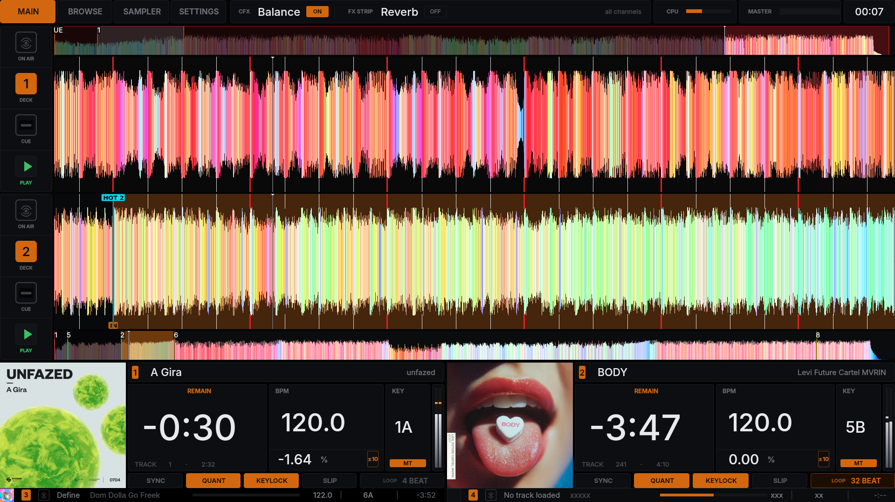
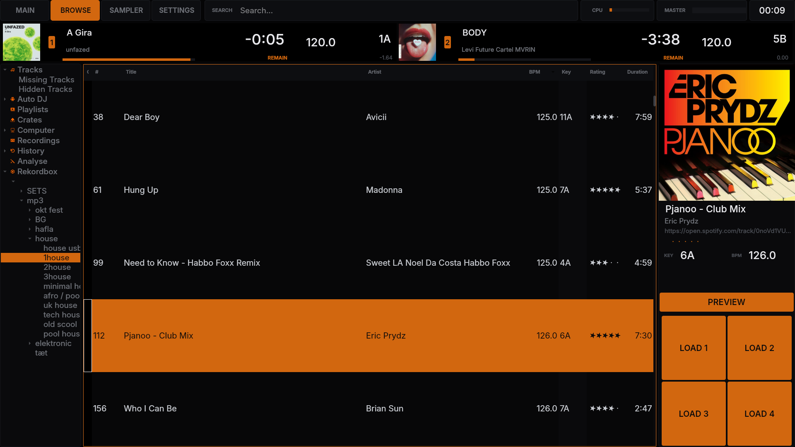
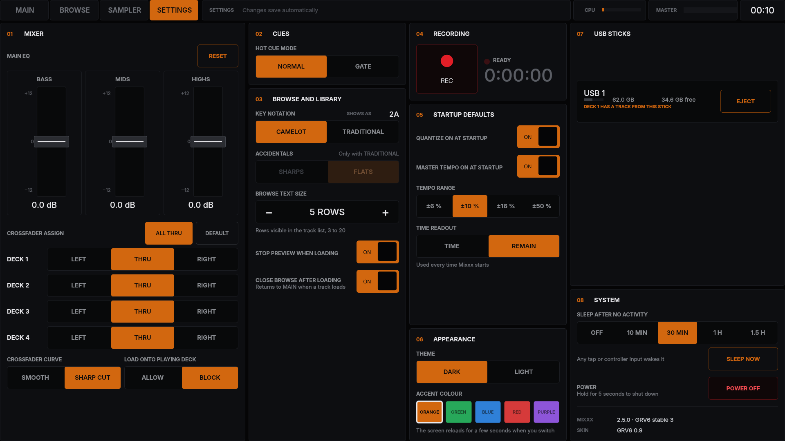
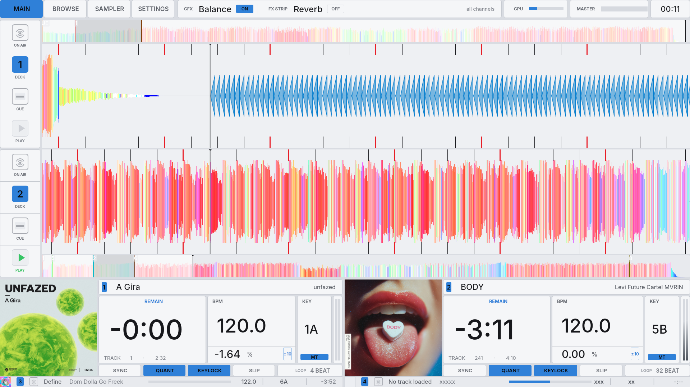

<div align="center">

# GRV6

**A standalone DJ system: Pioneer DDJ-GRV6 + Raspberry Pi 4 + touchscreen, running a patched Mixxx 2.5.**

A full-screen touch skin in the style of a Pioneer XDJ display, a custom controller mapping,
and a Mixxx build with better Rekordbox USB support and a kiosk-friendly system menu.

[](https://github.com/GitHubuser5o5/mixxx-grv6-build/actions/workflows/build-stable3.yml)
[](https://github.com/GitHubuser5o5/mixxx-grv6-build/releases/latest)
[](https://mixxx.org)
[](#hardware)
[](LICENSE)



</div>

---

## Contents

- [Features](#features)
- [Screenshots](#screenshots)
- [Hardware](#hardware)
- [Installation](#installation)
- [Updating](#updating)
- [Repository layout](#repository-layout)
- [Building Mixxx](#building-mixxx)
- [Working on the skin](#working-on-the-skin)
- [Known issues](#known-issues)
- [Roadmap](#roadmap)
- [Credits](#credits)
- [License](#license)

## Features

### Skin (`GRV6/`)
- **Four tabs:** Main, Browse, Sampler (work in progress) and Settings, all made for touch on a 1920x1080 screen with no mouse or keyboard.
- **Four decks, two at a time:** the controller's DECK buttons choose deck 1 or 3 on the left and 2 or 4 on the right. The other deck of each side stays visible as a small strip.
- **XDJ-style decks:** coloured scrolling waveforms with beat ticks and red downbeats, overviews, big time, BPM (one decimal) and key readouts, tempo range, master tempo, sync leader/follower, loop size, ON AIR.
- **Browse:** big rows (3-20 on screen), a fixed column layout, a key "traffic light" that turns green when a track mixes with the playing deck, track info and preview, LOAD 1-4.
- **Settings:** main EQ, crossfader assign and curve, hot cue mode (normal or gate), key notation, browse text size, recording, startup defaults, theme, USB sticks with safe eject, sleep timer and power off.
- **Themes:** dark and light, five accent colours.

### Controller mapping (`controller/`)
- A Pioneer DDJ-GRV6 mapping for four decks, with deck switching that follows the skin.
- Browse knob scrolls the library, zooms the waveforms on Main, and with SHIFT changes the row size.
- Hot cues, loops, FX and CFX, lights and VU meters; startup defaults come from the skin's Settings.

### Mixxx build (`patches/`)
39 patches on top of Debian's `mixxx 2.5.0+dfsg-3`. The most important:
- **Rekordbox USB:** no crash on damaged exports, complete playlists in the right order, accented file names, saved loops as loop cues, colour/BPM/rating columns.
- **Kiosk-friendly:** errors show as a banner the controller can dismiss instead of a dialog nobody can close; the sound card is retried at startup.
- **XDJ feel:** steady BPM readout, waveforms that don't react to the EQ, Echo and Reverb that ring out.
- **System backend for the Settings tab:** startup defaults, crossfader curve, sleep, power off with a shutdown screen, USB stick eject, theme switching.

Every patch is listed in [patches/README.md](patches/README.md).

## Screenshots

| Main | Browse |
|:---:|:---:|
|  |  |
| **Settings** | **Light theme** |
|  |  |

## Hardware

| Part | Notes |
|---|---|
| Raspberry Pi 4 | Raspberry Pi OS Lite (64-bit, Debian trixie) |
| Pioneer DDJ-GRV6 | connected over USB |
| Touchscreen | 1920x1080 |
| USB sticks | Rekordbox exports or plain music folders; FAT32, exFAT, NTFS |

## Installation

1. Flash **Raspberry Pi OS Lite (64-bit)** and log in on the Pi.
2. Get this repository:
   ```bash
   sudo apt install -y git
   git clone https://github.com/GitHubuser5o5/mixxx-grv6-build.git
   cd mixxx-grv6-build
   ```
3. Download `mixxx_*.deb` and `mixxx-data_*.deb` from the [latest release](https://github.com/GitHubuser5o5/mixxx-grv6-build/releases/latest) into that folder.
4. Run the setup script. It installs X and the helper tools, the Mixxx build, the skin and the mapping, starts Mixxx full screen at boot, and allows POWER OFF and USB eject without a password:
   ```bash
   bash pi/setup.sh
   ```
5. Reboot. In Mixxx, choose **Preferences > Interface > Skin: GRV6** and **Preferences > Controllers > DDJ-GRV6 Custom** (enable it).

> [!NOTE]
> The skin and mapping also work on a stock Mixxx 2.5, but the Settings tab, the error banners and most of the Browse features need the patched build.

## Updating

```bash
cd mixxx-grv6-build
git pull
bash pi/setup.sh
```

Skin changes take effect after a Mixxx restart. To install a new build only: `sudo apt install --allow-downgrades ./mixxx_*.deb ./mixxx-data_*.deb`.

## Repository layout

```
GRV6/            the Mixxx skin (copy to ~/.mixxx/skins/)
controller/      DDJ-GRV6 mapping and script (copy to ~/.mixxx/controllers/)
patches/         Mixxx patches and the two series files
pi/              Raspberry Pi setup: setup.sh, xinitrc, Onboard keyboard theme
tools/           generators for the skin's XML, themes and images
docs/            developer notes and a screen-by-screen reference
.github/         build workflows
```

## Building Mixxx

The build runs on GitHub Actions (arm64, Debian trixie container): **Actions > Build Mixxx 2.5.0 stable 3 > Run workflow**. It fetches the Debian source package, applies [`patches/series-stable3`](patches/series-stable3) and publishes the two .deb files as a release named `stable3-rN`.

| Build | Series | Version | State |
|---|---|---|---|
| Stable 3 | [`series-stable3`](patches/series-stable3) | `2.5.0+dfsg-3+grv6.s3rN.1` | current |
| Stable 2 | [`series`](patches/series) | `2.5.0+dfsg-3+grv6.rN.1` | frozen fallback |

How to add a patch is described in [patches/README.md](patches/README.md#adding-a-patch).

## Working on the skin

Most of the skin is generated. Edit the generators, not the XML:

```bash
python tools/build_skin.py    # skin.xml, main.xml, browse.xml, settings.xml, ..., themes/*.qss
python tools/make_images.py   # images/ (needs Pillow)
```

`GRV6/style.qss` and the remaining templates are edited by hand; `tools/themes.py` holds the colour themes.
The controls shared by the skin, the mapping and the patched build are documented in [docs/skin-notes.md](docs/skin-notes.md); everything on screen is listed in [docs/skin-inventory.md](docs/skin-inventory.md).

## Known issues

- Sorting a Rekordbox playlist by **Key** can empty the list (a stock Mixxx bug). Sort by another column to get it back.
- Retriggering a loop hot cue can occasionally play a sliver past the loop end.

## Roadmap

- [ ] **Sampler tab** (work in progress): the 16 sample pads work, the final design is still to come
- [ ] **RMX-1000 integration** (coming): an RMX EMU tab with Pioneer RMX-1000-style effects
- [ ] Optional slow stop on PLAY (off by default)

## Credits

- [Mixxx](https://mixxx.org), the open-source DJ software this is built on, and Debian's `mixxx` package.
- [joergbeyer/dj-controller](https://github.com/joergbeyer/dj-controller): the original DDJ-GRV6 mapping the controller files are based on.
- [ntamas94/pioneered-by-ntamas](https://github.com/ntamas94/pioneered-by-ntamas): several patches (library zoom, Rekordbox fixes) are ported from it.

This project is not affiliated with or endorsed by Pioneer DJ, AlphaTheta or the Mixxx project. Product names are used only to describe compatibility.

## License

[GPL-3.0](LICENSE). Mixxx is GPL-2.0-or-later and the mapping and ported patches are GPL-3.0, so the project as a whole is distributed under GPL-3.0.
